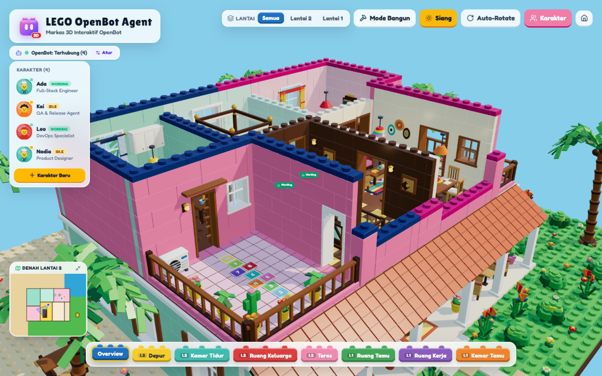
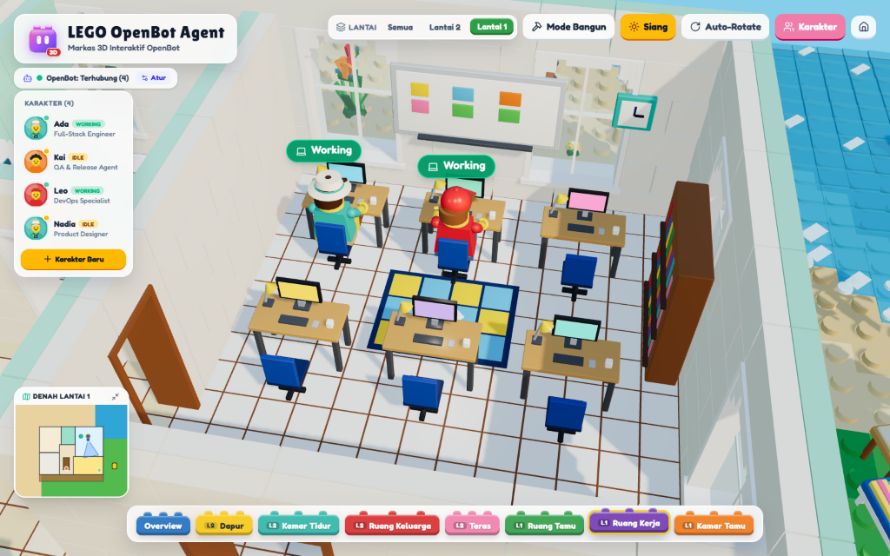
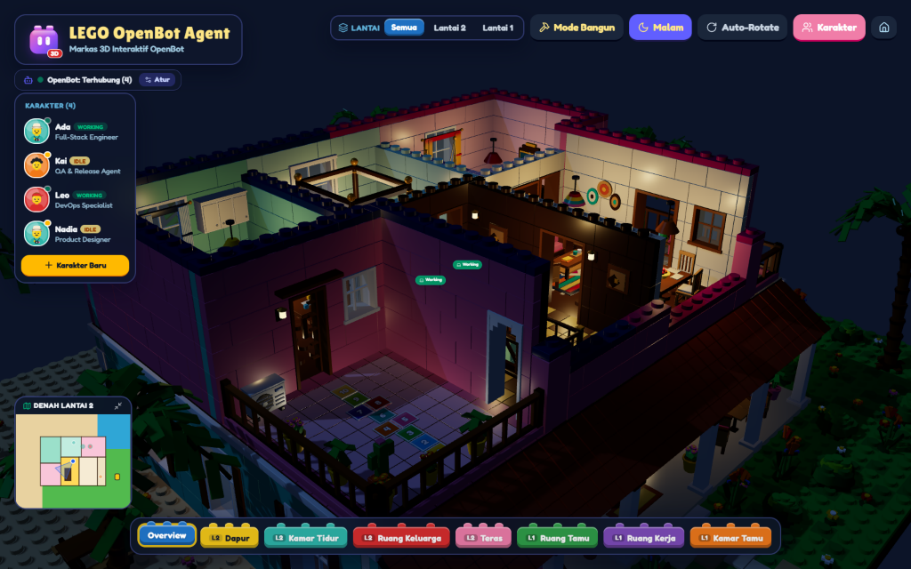
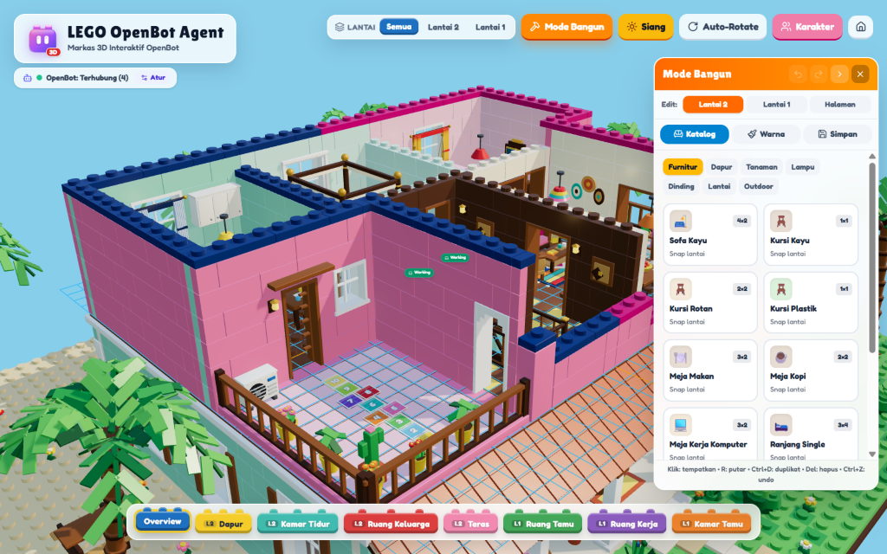
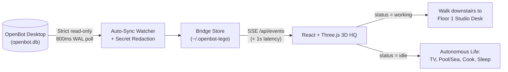

<div align="center">


# LEGO OpenBot Agent (`openbot-lego`)

**Turn your local OpenBot Desktop agents into a living 3D LEGO Tropical Headquarters.**

Watch your AI agents walk downstairs to their workstations when they start thinking, typing away with live task badges, and unwind around the house & beachfront once they finish — all powered by procedural **Three.js** geometry and **zero-config** SQLite auto-sync.

[](https://www.npmjs.com/package/openbot-lego)
[](https://nodejs.org/)
[](./LICENSE)
[](https://github.com/RajaskaJanuardani/lego-openbot-agent)

[**Quick Start**](#-quick-start) · [**Visual Tour**](#-visual-tour) · [**Interactive Shortcuts**](#-interactive-cli--tray) · [**Architecture**](#-live-sync-architecture) · [**Explore Rooms**](#-explore-the-house)

<br />



</div>

---

## Visual Tour

<table>
  <tr>
    <td width="50%">
      
      <p align="center"><strong>Floor 1 · Live Agent Studio</strong><br /><sub>Active agents walk downstairs to computer desks with real-time <code>Working</code> badges</sub></p>
    </td>
    <td width="50%">
      
      <p align="center"><strong>Day & Night Lighting</strong><br /><sub>Toggle warm interior pendant lamps, bedside lanterns, and ocean moonshine</sub></p>
    </td>
  </tr>
  <tr>
    <td width="50%">
      
      <p align="center"><strong>Interactive Build Mode</strong><br /><sub>Stud-snapping catalog, 24 LEGO colors, wall/floor painting, and JSON export</sub></p>
    </td>
    <td width="50%">
      
      <p align="center"><strong>Two-Story Cutaway & Free Camera</strong><br /><sub>360° orbit, WASD pan, character follow-cam, and clickable live minimap</sub></p>
    </td>
  </tr>
</table>

---

## Quick Start

> [!IMPORTANT]
> Requires **Node.js `>= 22.5.0`** (uses built-in `node:sqlite` for zero-dependency read-only OpenBot sync) and **OpenBot Desktop** installed on Windows, macOS, or Linux.

```bash
npm install -g openbot-lego
openbot-lego
```

Or launch immediately without global installation:

```bash
npx openbot-lego
```

> [!TIP]
> **Zero Configuration Required.** On startup, `openbot-lego` automatically discovers `openbot.db`, starts a unified HTTP + SSE + 3D server on `http://localhost:4310`, spawns a matching LEGO minifigure for every OpenBot agent, and opens your browser.

---

## Interactive CLI & Tray

When you run `openbot-lego`, the terminal becomes an interactive control console with live status, OS startup integration, System Tray handoff, and one-key self-updates:

```text
    ███  ███     LEGO OpenBot Agent  v1.2.1
  ▄██████████▄   Markas 3D Interaktif Real-Time untuk OpenBot Desktop
  ████████████   ────────────────────────────────────────────────────
  ████████████   Command: openbot-lego  ·  Tray / Auto-Start / Auto-Update
  ▀██████████▀

  ✔ Node.js       v24.15.0
  ✔ OpenBot DB    Terdeteksi (4 agent aktif)
  ✔ Auto-Start    Aktif saat laptop hidup
  ✔ Markas 3D     http://localhost:4310

  ➜ Membuka browser...
  Pintasan:  [H] Hide to Tray (Background)  [A] Toggle Auto-Start  [O] Buka Web  [Q] Keluar
```

### Live Terminal Keycaps

| Shortcut | Action |
| :---: | :--- |
| <kbd>H</kbd> | **Hide to Tray (Background)** — detaches server to background + launches System Tray icon *(Windows)* |
| <kbd>A</kbd> | **Toggle Auto-Start** — enables/disables silent launch when your laptop boots |
| <kbd>U</kbd> | **One-Key Self-Update** — appears automatically when a newer release hits npm |
| <kbd>O</kbd> | Re-open `http://localhost:4310` in your default browser |
| <kbd>Q</kbd> | Gracefully stop the server and exit (<kbd>Ctrl</kbd> + <kbd>C</kbd> also works) |

<details>
<summary><strong>Click to expand: Full CLI Commands & Flags Reference</strong></summary>

#### Commands

| Command | Description |
| :--- | :--- |
| `openbot-lego` / `start` | Launch the 3D server, auto-sync OpenBot agents, and open browser |
| `openbot-lego background` | Launch silently in background with System Tray icon |
| `openbot-lego tray` | Alias for `openbot-lego background` |
| `openbot-lego stop` | Gracefully stop background daemon and remove System Tray icon |
| `openbot-lego autostart on` | Register hidden startup launcher on login (Windows / macOS / Linux) |
| `openbot-lego autostart off` | Remove OS login startup entry |
| `openbot-lego autostart status` | Inspect current startup registration and path |
| `openbot-lego status` | Print background daemon status and live `WORKING` / `IDLE` agent table |
| `openbot-lego doctor` | Check Node.js version, web bundle, `openbot.db`, and daemon health |
| `openbot-lego update` | Self-update global `openbot-lego` installation from npm |
| `openbot-lego logs` | View recent background daemon logs |
| `openbot-lego reset` | Clear local CLI config and cached state (`~/.openbot-lego`) |

#### Options

| Flag | Default | Description |
| :--- | :--- | :--- |
| `-p`, `--port <port>` | `4310` | Custom HTTP server port |
| `--host <host>` | `127.0.0.1` | Bind host address |
| `-d`, `--daemon`, `--tray` | `false` | Start directly in background + System Tray mode |
| `--no-open` | `false` | Do not open browser tab automatically |
| `-v`, `--version` | — | Show CLI version |
| `-h`, `--help` | — | Show help message |

</details>

---

## Live Sync Architecture



> [!NOTE]
> OpenBot's database is always opened with `{ readOnly: true }`. Secrets resembling bearer tokens or API keys are redacted automatically before ever reaching the browser UI.

<details>
<summary><strong>Click to expand: Default OpenBot DB Locations & Web Settings Panel</strong></summary>

#### Auto-Detected OS Paths

| OS | Default `openbot.db` Location |
| :--- | :--- |
| **Windows** | `%APPDATA%\OpenBot\openbot.db` |
| **macOS** | `~/Library/Application Support/OpenBot/openbot.db` |
| **Linux** | `~/.config/OpenBot/openbot.db` |

#### In-Browser Controls (`Atur` Button)

Everything can also be managed directly in the web HUD (top-left **`Atur`** button):
- Toggle **Auto-Sync OpenBot Desktop** ON/OFF or point to a custom `openbot.db` file path
- Toggle **Launch Automatically at Laptop Startup** right from the browser
- Click **Test** on any agent to preview a 12-second `Working` cycle in the Studio
- Click **Edit Outfit** to customize any agent's LEGO minifigure appearance (saved per `agentId`)
- Perform a full factory reset via **Atur → Reset ke Awal** or by opening `http://localhost:4310/?reset=1`

</details>

---

## Explore the House

### Camera & Floor Navigation

| Control | Action |
| :--- | :--- |
| **Left Drag** | 360° camera orbit |
| **Right Drag** / <kbd>Shift</kbd> + **Drag** | Pan parallel to floor |
| **Scroll** / **Pinch** | Zoom in and out |
| <kbd>W</kbd> <kbd>A</kbd> <kbd>S</kbd> <kbd>D</kbd> / **Arrows** | Glide camera target across rooms |
| <kbd>Q</kbd> / <kbd>E</kbd> | Rotate camera horizontally |
| **Double-Click Floor** | Smooth focus onto clicked tile or ground point |
| <kbd>G</kbd> | Toggle multi-floor A\* navigation graph debug overlay |

<details>
<summary><strong>Click to expand: Rooms Across Floor 1, Floor 2 & Beachfront</strong></summary>

| Zone | Rooms & Interactive Highlights |
| :--- | :--- |
| **Floor 1** *(Interior)* | **Agent Studio** (6 computer workstations, sticky-note whiteboard, bookshelf, wall clock) · **Foyer & Living Room** (animated LEGO TV, rattan sofa) · **Guest Room** (single bed, wardrobe) · **Mint Bathroom** (walk-in glass shower, vanity sink) · **Laundry Room** (front-loading washer, drying rack) · **12-Step Staircase Hall** · **Front Porch** |
| **Floor 2** *(Cutaway)* | **Kitchen** (silver fridge, stove with frying pan, sink, breakfast table) · **Master Bedroom** (4-poster wooden canopy bed, warm bedside lanterns) · **Dressing Room** (suspended white fabric hammock, carved vanity mirror) · **Living & Dining Area** · **Left Terrace** (1–10 hopscotch grid, AC unit) · **Right Terrace** |
| **Outdoors** | **Sandy Beachfront** · **Animated Blue Ocean** (buoy, swim zone) · **Blue Beach Lounge Chair & Umbrella** · **Yellow Tuk-Tuk (Bajaj)** · **Coconut Palms & Garden Paths** |

> Selecting **Lantai 1** in the top bar hides Floor 2 cleanly and disables Floor 2 raycasts so you can click directly inside ground-floor rooms.

</details>

<details>
<summary><strong>Click to expand: 16 Asset-Matched Agent Animations & Customization</strong></summary>

- **Working (`working`)**: Strictly active while the linked OpenBot agent is processing a message or routine — seated typing at a Floor 1 Studio workstation.
- **Idle Lifestyle (`idle`)**:
  - **Drinking** from the kitchen silver fridge (holding cold cyan cup + straw)
  - **Cooking** over the kitchen stove (holding spatula + rising steam puffs)
  - **Washing** dishes at the kitchen sink or laundry washer (soap bubbles)
  - **Watching TV** on Floor 1 sofa/armchair (clicking LEGO TV remote)
  - **Showering** inside Floor 1 glass shower (falling water droplets + bubbles)
  - **Sleeping** horizontally on Floor 1/2 beds with floating `Zzz…` indicator
  - **Swinging** reclined in the Floor 2 white fabric hammock
  - **Swimming** freestyle in the ocean waves (windmill arms, flutter kicks, splash droplets)
  - **Sunbathing** reclined on the beach lounge chair
  - **Hopscotch** hopping on Left Terrace · **Vanity Mirror** styling · **Multi-Agent Indonesian Chat**
- **Modular Character Creator**: Customize skin tone, head shape/scale, canvas-rendered faces, 10 hairstyles, 7 headwear pieces, 10 torso designs + patterns, bottoms, footwear, height/build, and 6 accessory slots with live 3D turntable preview.
- **Interactive Build Mode**: 24 LEGO colors, wall/trim/floor recoloring, 29+ catalog items with stud-grid snapping and AABB collision check, 60-step Undo/Redo (<kbd>Ctrl</kbd>+<kbd>Z</kbd>), and Zod-validated JSON Export/Import.

</details>

<details>
<summary><strong>Click to expand: Optional External Webhook REST & SSE API</strong></summary>

External scripts or remote workers can push presence updates using the Bearer token shown under **Atur → Opsi Lanjutan**:

| Endpoint | Method | Auth | Purpose |
| :--- | :---: | :---: | :--- |
| `/api/health` | `GET` | — | Bridge status, mode, and SQLite diagnostics |
| `/api/agents` | `GET` | — | List all active agents |
| `/api/events` | `GET` | — | Real-time Server-Sent Events stream (`snapshot`, `agents`, `ping`) |
| `/api/agents/register` | `POST` | Bearer | Register or update an external agent profile |
| `/api/agents/:agentId/status` | `POST` | Bearer | Push `working` / `idle` state with 1-sentence task summary |
| `/api/agents/:agentId/heartbeat` | `POST` | Bearer | Extend active timeout for long-running tasks |

</details>

---

## Development

<details>
<summary><strong>Click to expand: Run from Source, Build Scripts & Troubleshooting</strong></summary>

```bash
git clone https://github.com/RajaskaJanuardani/lego-openbot-agent.git
cd lego-openbot-agent
npm install
npm run dev
```

During development, Vite embeds the OpenBot Bridge middleware directly (`bridge/vitePlugin.ts`), serving both the React Three Fiber UI and `/api/*` on `http://localhost:5173`.

| Script | Purpose |
| :--- | :--- |
| `npm run dev` | Start Vite dev server with embedded OpenBot Bridge (`:5173`) |
| `npm run build` | Type-check (`tsc -b`), bundle web UI (`dist/`), and compile CLI (`dist-cli/cli.mjs`) |
| `npm run build:cli` | Rebuild CLI executable bundle only |
| `npm run preview` | Serve production build locally with embedded Bridge |
| `npm run bridge` | Run standalone Bridge server (`:4310`) |
| `npm run simulate-agent` | Simulate 3 sample agents cycling `working` / `idle` states |

#### Troubleshooting

- **0 agents appear on launch**: Open **Atur** in the top-left HUD to inspect the detected `openbot.db` path or paste a custom path manually.
- **SQLite error on startup**: Ensure `node -v` outputs **`v22.5.0`** or higher.
- **Need a clean slate?** Run `openbot-lego reset` in your terminal or open `http://localhost:4310/?reset=1`.

</details>

---

## License

Released under the [MIT License](./LICENSE).
